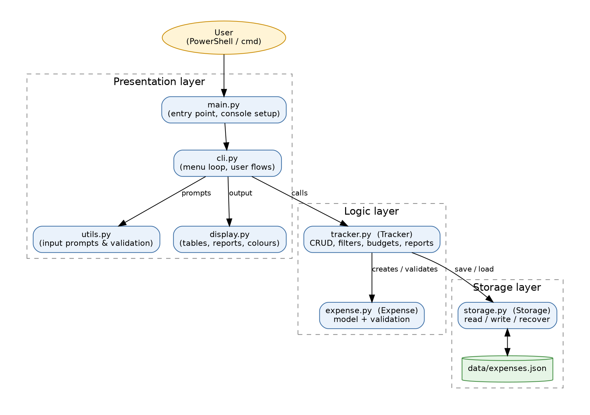
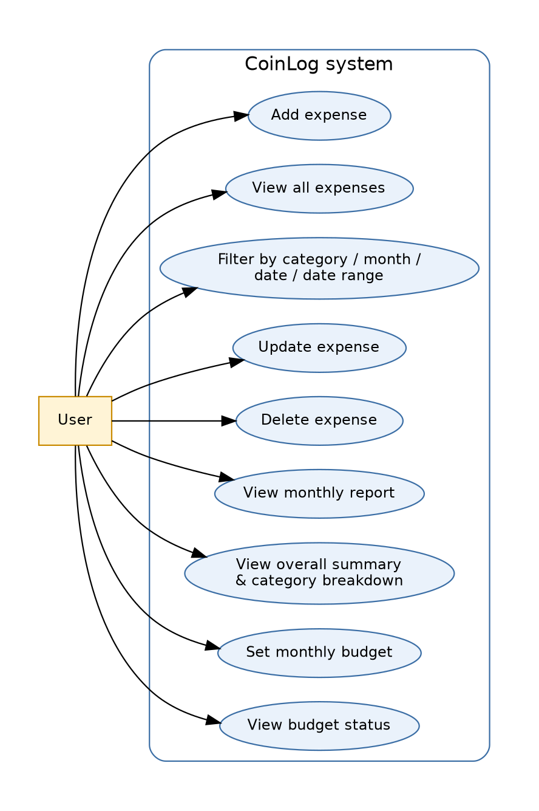
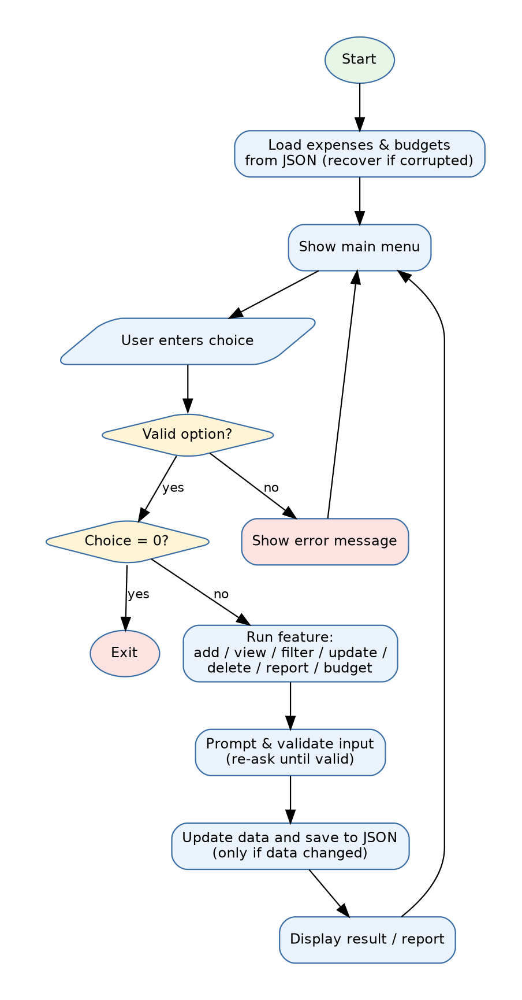
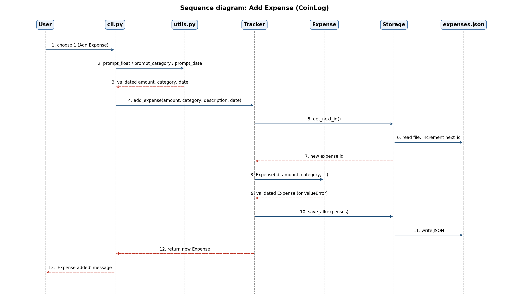
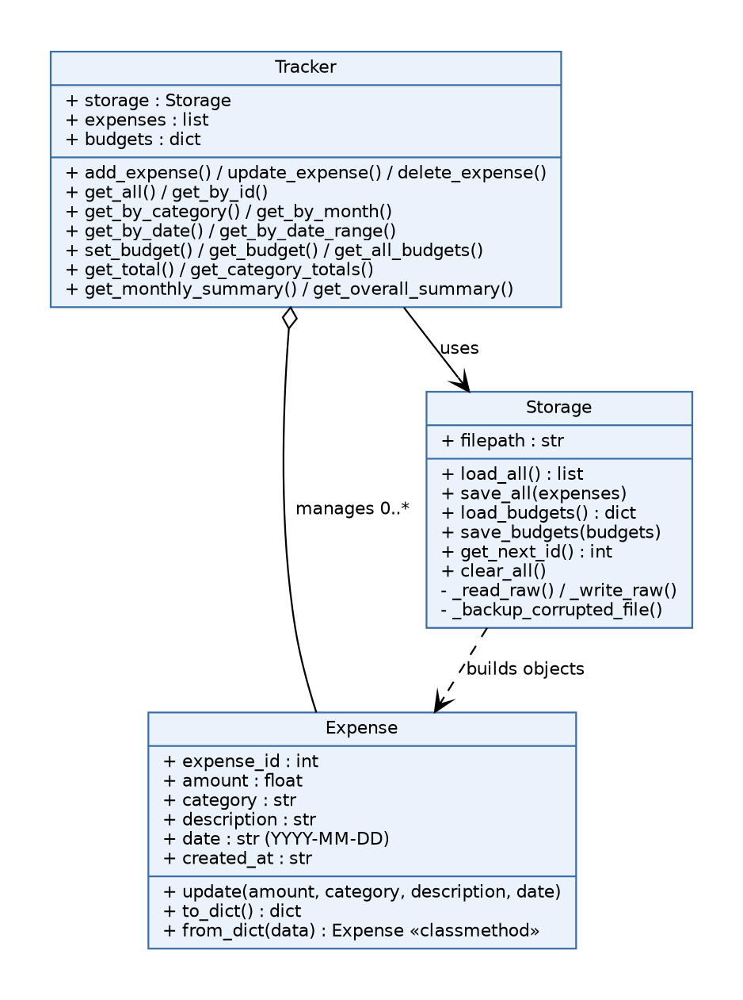
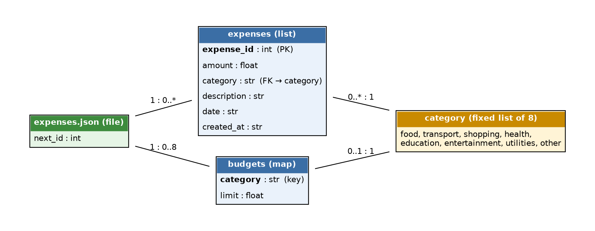

# CoinLog: A Command-Line Expense Tracker

CoinLog is a terminal-based application that lets a person record daily expenses, sort them by category, and compare monthly spending against a budget. It is written in Python and needs nothing beyond Python itself to run.

**Author:** Gautham, VIT Bhopal
**Course:** Python Essentials (VITyarthi)

---

## 1. Overview

Most people have a rough sense of what they spend but no actual record of it. Small daily purchases — food, transport, a subscription — add up quietly, and by the end of the month it is hard to say where the money went. A spreadsheet works but takes effort for a quick entry, and most expense apps expect an account and an internet connection.

CoinLog is built to remove that friction. A user opens a terminal, types a number to pick a menu option, and logs an expense in a few seconds. Every entry is saved automatically to a local file, so nothing needs to be exported or synced. The tool is aimed at students and anyone else who wants a fast, private, offline way to see where their money is going.

**Objectives**
- Let a user record an expense in a few seconds, with no account or setup
- Organise spending by category so patterns are easy to see
- Let a user set a monthly budget per category and get warned when spending goes over it
- Keep all data on the user's own machine, as a plain, human-readable file

---

## 2. Features

CoinLog has 12 menu options, organised into three functional modules.

**Module 1 — Expense Management**
- Add an expense (amount, category, an optional description, and a date; the date defaults to today if left blank)
- View every expense, most recent first, with a running total
- Update any field of an existing expense
- Delete an expense (the program asks for confirmation first)

**Module 2 — Search and Filtering**
- Filter by category
- Filter by month
- Filter by an exact date
- Filter by a date range

**Module 3 — Reports and Budgets**
- Monthly report: total spent per category for a chosen month, compared against that category's budget
- Overall summary: total spent, total for the current month, and a bar chart of spending by category
- Set a monthly budget for any category
- View budget status: a progress bar per category showing how much of the budget has been used, with a warning once it is exceeded

**Supporting behaviour**
- Every input is validated. An invalid amount, date or category produces a message and asks again, rather than crashing.
- Data is written to disk after every change, so nothing is lost if the window is closed.
- If the data file is ever unreadable, CoinLog saves a backup copy of it under a new name and starts with an empty file instead of crashing.
- Output uses colour where the terminal supports it, and falls back automatically to plain text where it does not.

---

## 3. Technologies Used

CoinLog is written in Python 3 and uses only modules that come built into Python. Nothing needs to be installed with `pip`.

| Module | What it is used for |
|---|---|
| `json` | Reading and writing the data file (`data/expenses.json`) |
| `os` | Building file paths and creating the `data` folder on first run |
| `datetime` | Checking that dates and months are real, and finding "today" and "this month" |
| `collections.defaultdict` | Adding up totals per category |
| `shutil` | Copying a damaged data file to a backup before starting fresh |
| `sys`, `ctypes` | Setting the terminal to UTF-8 and enabling colour on Windows at startup |
| `unittest` | The automated test suite |
| `unittest.mock`, `tempfile`, `io`, `contextlib`, `importlib`, `subprocess`, `pty` | Supporting the tests — simulating keyboard input, using temporary files, and running the program itself to check its output |

The project practises several core Python ideas: classes and methods, a classmethod used for rebuilding objects from saved data, dictionaries and lists, list comprehensions, sorting with a key function, f-strings, exception handling, and reading and writing files.

---

## 4. Project Structure

```
coinlog/
├── main.py                  Entry point — run this file to start the program
├── requirements.txt         Empty; no external packages are needed
├── README.md
├── statement.md             Problem statement, scope, and target users
├── .gitignore
├── data/
│   └── expenses.json        Created automatically the first time the program runs
├── coinlog/
│   ├── __init__.py
│   ├── expense.py           Expense class — one record, with validation
│   ├── tracker.py           Tracker class — add/update/delete, filtering, budgets, reports
│   ├── storage.py           Storage class — reads and writes the JSON file
│   ├── display.py           Everything printed to the screen
│   ├── utils.py             Input prompts that re-ask until an answer is valid
│   └── cli.py                The menu loop and the steps for each feature
├── docs/
│   └── diagrams/             Architecture, use case, workflow, sequence, class and ER diagrams
└── tests/
    ├── test_expense.py
    ├── test_tracker.py
    └── test_storage_and_cli.py
```

The program is split into three layers. `cli.py`, `display.py` and `utils.py` handle everything the user sees and types. `tracker.py` and `expense.py` hold the actual rules — what counts as a valid expense, how totals are calculated. `storage.py` is the only file that touches the data file on disk. Keeping these separate means a change to how something is displayed cannot accidentally break how data is saved, and the other way around.

---

## 5. Setup and Run

**Requirement:** Python 3, already installed on this machine. No other software is needed.

**Step 1 — Confirm Python works**

In PowerShell or cmd:
```
python --version
```
If that isn't recognised, try `py --version` instead.

**Step 2 — Get the project onto the machine**

Either download the ZIP from the GitHub repository and extract it, or clone it:
```
git clone <the repository URL>
```

**Step 3 — Open a terminal in the project folder**

Move into the folder that contains `main.py`. For example, in PowerShell:
```
cd path\to\coinlog
```
Running `dir` should list `main.py`, `README.md`, and the `coinlog` and `tests` folders.

**Step 4 — Run it**
```
python main.py
```
The banner and main menu appear. Enter a number and press Enter to choose an option; enter `0` to exit. The `data` folder and the `expenses.json` file inside it are created automatically the first time the program runs — there is nothing to configure beforehand.

**Menu reference**

| Option | Action |
|:--:|---|
| 1 | Add an expense |
| 2 | View all expenses |
| 3 | View expenses by category |
| 4 | View expenses by month |
| 5 | View expenses by date |
| 6 | View expenses by date range |
| 7 | Update an expense |
| 8 | Delete an expense |
| 9 | Monthly summary report |
| 10 | Overall summary and category breakdown |
| 11 | Set a monthly budget |
| 12 | View budget status |
| 0 | Exit |

Valid categories are: food, transport, shopping, health, education, entertainment, utilities, other. Dates are entered as `YYYY-MM-DD` and months as `YYYY-MM`.

---

## 6. Testing Instructions

The project includes 37 automated tests. From the project folder, run:
```
python -m unittest discover
```
This should finish with `Ran 37 tests` followed by `OK`. Adding `-v` shows every individual test as it runs:
```
python -m unittest discover -v
```

**What the tests check**

| File | Number of tests | Covers |
|---|:--:|---|
| `tests/test_expense.py` | 10 | An expense rejects invalid amounts, dates and categories, and correctly saves and reloads |
| `tests/test_tracker.py` | 13 | Adding, updating, deleting, filtering, totals, budgets and monthly reports |
| `tests/test_storage_and_cli.py` | 14 | Every file in the project imports without error, a damaged data file is recovered rather than crashing the program, data survives being closed and reopened, and the actual menu handles both valid and invalid input correctly |

The tests write to temporary files created for the test run only, so running them never changes or deletes the user's real expense data.

---

## 7. Screenshots and Results

The blocks below show real output from running the program, with a saved copy of the data confirmed against it. Colour does not display in plain text but appears in an actual terminal.

**Main menu**
```
──────────────────────────────────────────────────────────────────────
  MAIN MENU
──────────────────────────────────────────────────────────────────────
   1  Add Expense
   2  View All Expenses
   3  View Expenses by Category
   4  View Expenses by Month
   5  View Expenses by Date
   6  View Expenses by Date Range
   7  Update Expense
   8  Delete Expense
   9  Monthly Summary Report
  10  Overall Summary & Category Breakdown
  11  Set Monthly Budget
  12  View Budget Status
   0  Exit
──────────────────────────────────────────────────────────────────────
```

**Adding an expense**
```
  ── Add New Expense ──
  Amount (₹): 250
  Category [...]: food
  Description (optional) []: Lunch at canteen
  Date (YYYY-MM-DD, leave blank for today): 2026-09-10

  ✔  Expense #1 — ₹250.00 [food] added.
```

**Monthly report, showing a category over its budget**
```
──────────────────────────────────────────────────────────────────────
  📅  Monthly Report — 2026-09
──────────────────────────────────────────────────────────────────────
  Food            Spent: ₹250.00  Budget: ₹200.00 ⚠ OVER BUDGET
  Transport       Spent: ₹60.00  No budget set
  Shopping        Spent: ₹1200.00  No budget set
──────────────────────────────────────────────────────────────────────
  TOTAL SPENT       ₹1510.00
──────────────────────────────────────────────────────────────────────
```

**Overall summary**
```
──────────────────────────────────────────────────────────────────────
  💰  CoinLog Overview
──────────────────────────────────────────────────────────────────────
  Total Entries       : 3
  Total Spent (All)   : ₹1510.00
  Spent This Month    : ₹1510.00

  Breakdown by Category:
  Food           ████  ₹250.00
  Shopping       ████████████████████  ₹1200.00
  Transport      █  ₹60.00
──────────────────────────────────────────────────────────────────────
```

**Budget status**
```
──────────────────────────────────────────────────────────────────────
  🎯  Budget Status — 2026-09
──────────────────────────────────────────────────────────────────────
  Food           [████████████████████] ₹250.00/₹200.00 OVER!
──────────────────────────────────────────────────────────────────────
```

**Test suite**
```
Ran 37 tests in 4.108s

OK
```

---

## 8. Design Diagrams

Six diagrams, drawn from the structure of the actual code, are provided in `docs/diagrams/`.

**System architecture**



**Use case diagram**



**Workflow diagram**



**Sequence diagram — adding an expense**



**Class diagram**



**Data storage (ER) diagram**



### Schema Design

CoinLog stores its data as JSON rather than in a database, so there are no formal database tables. The JSON file has a fixed structure, described below exactly as the code builds it.

**Top level of `data/expenses.json`**

| Key | Type | Description |
|---|---|---|
| `expenses` | array of objects | every recorded expense |
| `budgets` | object | maps a category name to its budget amount |
| `next_id` | integer | counter used to give each new expense a unique id |

**Each object inside `expenses`**

| Field | Type | Constraints |
|---|---|---|
| `expense_id` | integer | unique; assigned automatically; never reused, even after a delete |
| `amount` | float | must be greater than 0; stored rounded to 2 decimal places |
| `category` | string | one of: food, transport, shopping, health, education, entertainment, utilities, other |
| `description` | string | optional; blank if not given |
| `date` | string | format `YYYY-MM-DD`; defaults to today if left blank |
| `created_at` | string | format `YYYY-MM-DD HH:MM:SS`; set automatically |

**Each entry inside `budgets`**

| Field | Type | Constraints |
|---|---|---|
| key | string | a category name, from the same fixed list |
| value | float | must be greater than 0 |

**Example record**
```json
{
  "expense_id": 1,
  "amount": 250.0,
  "category": "food",
  "description": "Lunch at canteen",
  "date": "2026-09-10",
  "created_at": "2026-09-10 13:42:07"
}
```

---

## 9. Known Limitations

- All amounts are treated as rupees; there is no multi-currency support.
- The category list is fixed at eight and cannot be extended from the menu.
- The program supports a single user with a single data file at a time.
- There is no graphical interface; all interaction happens through the terminal.

## 10. Possible Future Enhancements

- Exporting expenses to a CSV file
- Editing an existing budget rather than only setting a new one
- Recurring expenses that are logged automatically
- Searching expenses by keyword in the description
- A simple graphical front end built on top of the same `Tracker` class

---

## Author

**KONDURU SHAKTHIDHAR SRIVATSA GAUTHAM**, VIT Bhopal
Built for the Python Essentials course on VITyarthi.
